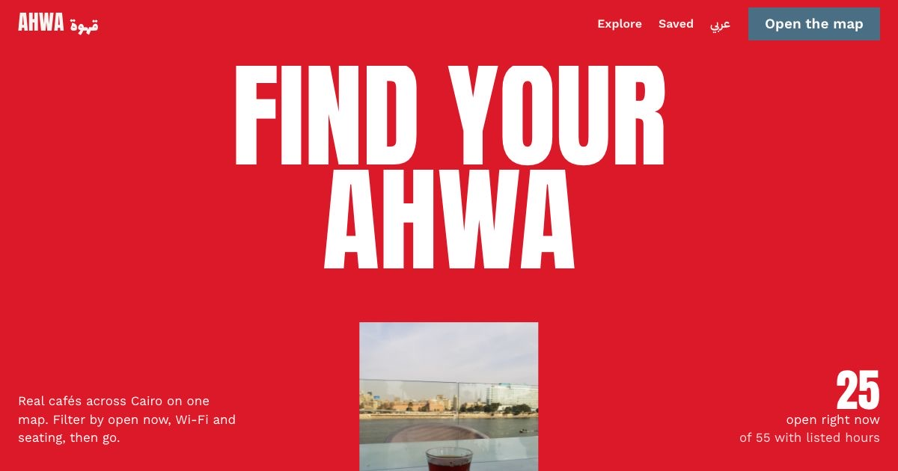

# Ahwa · قهوة

**Find a café to study in Cairo.** Ahwa maps 341 real cafés across Greater Cairo and lets you filter by *open now*, Wi-Fi, outdoor seating, air-conditioning and more, in English or Arabic.



## Features

- **Map and list together.** Hover a café and its pin lights up; tap a pin and its card scrolls into view. On phones the list is a draggable sheet over a full-screen map.
- **Open now, for real.** Opening hours are parsed from OpenStreetMap and evaluated in Cairo time, with "closes in 40 min" style countdowns.
- **Filters in the URL**, so any search can be shared.
- **Near me** sorts by walking distance from your location.
- **Café pages** with this week's hours, what is known (and honestly, what is not listed), your own notes on noise and power outlets, and directions.
- **Saved list**, kept on your device.
- **Arabic and English**, with a full right-to-left layout and Arabic typefaces.
- **Motion:** masked headline reveal, scroll-linked hero, a working poster-size "Open now" switch, parallax archive photographs, a timeline that wipes in on scroll, shared-element page transitions (View Transitions API), and a reduced-motion version of all of it.

## Built with

React 19, TypeScript, Vite, React Router, Leaflet / react-leaflet, Motion, Lenis and opening_hours.

## Data

Café data © [OpenStreetMap](https://www.openstreetmap.org/copyright) contributors, ODbL 1.0. To refresh it, download cafés for Greater Cairo from the Overpass API into `scripts/raw/cafes.json`, then run:

```bash
python3 scripts/build-data.py scripts/raw src/data/cafes.json
```

Coverage is uneven: only some cafés list hours, Wi-Fi or seating, and the app says "Not listed" instead of guessing. Every café page links to OpenStreetMap so missing details can be added at the source.

## Run locally

```bash
npm install
npm run dev
```

## Photo credits

- "A glwaa of tea on the Nile in Cairo" by DawoudHusseini, CC BY-SA 4.0, Wikimedia Commons
- "Cafe Riche" by Nableezy, CC BY-SA 3.0, Wikimedia Commons
- "Coffee House and Mosque Entrance, Cairo" by Robert Charles Goff, CC0, Wikimedia Commons
- "Cairo, Street Scene" (early 1900s postcard), public domain, Wikimedia Commons
- "Coffee-shop, Cairo, Egypt", coloured lithograph, CC0, rawpixel
- "Cairo, Talaat Harb Street" by Vyacheslav Argenberg, CC BY 4.0, Wikimedia Commons

Map tiles © OpenStreetMap contributors.
